# UrutiX User Manual

**Logistics matching, fleet operations, financing, and compliance — by role**

Use this manual as the system walkthrough. Find your role, follow the login path, then use the screen-by-screen flows to complete work without a live presentation.

---

## How to use this document

1. Read **Getting started** once (login, password setup, KYC, how the header works).
2. Jump to **your role** in [Role index](#role-index).
3. Use the **end-to-end flow** in that chapter for day-to-day work.
4. Use [Cross-role system flow](#1-cross-role-system-flow) when you need to see how cargo, trucks, drivers, brokers, lenders, and admins connect.

Menu names in this manual match the labels you see in the top navigation (desktop) and the bottom bar (mobile).

---

## Table of contents

1. [Getting started](#getting-started)
2. [How to navigate](#how-to-navigate)
3. [Cross-role system flow](#1-cross-role-system-flow)
4. [Cargo Owner](#2-cargo-owner)
5. [Cargo Receiver](#3-cargo-receiver)
6. [Truck Owner and fleet staff](#4-truck-owner-and-fleet-staff)
7. [Driver](#5-driver)
8. [Broker](#6-broker)
9. [Lender](#7-lender)
10. [Tenant Admin](#8-tenant-admin)
11. [Super Admin and Admin](#9-super-admin-and-admin)
12. [Operational Admin](#10-operational-admin)
13. [Customs Officer](#11-customs-officer)
14. [Parking Reservation Manager](#12-parking-reservation-manager)
15. [Shared tools](#13-shared-tools)
16. [Quick reference](#14-quick-reference)

---

## Role index

| Role | Who it is for | After login you land on |
| --- | --- | --- |
| **Cargo Owner** | Shippers posting loads and finding trucks | `/dashboard` |
| **Cargo Receiver** | Destination contacts confirming deliveries | `/dashboard` |
| **Truck Owner** | Fleet owners providing trucks and drivers | `/dashboard/fleet` |
| **Fleet Manager / Dispatcher / Accountant / Safety Officer** | Staff of a truck owner | Fleet dashboard (limited tabs) |
| **Driver** | Assigned trips, inspections, parking, earnings | `/dashboard/driver` |
| **Broker** | Intermediaries matching cargo to trucks | `/dashboard/broker` |
| **Agent** | Field/agent users supporting matching | `/dashboard` (shared cargo tools) |
| **Lender** | Financing cargo and trip loans | `/lender` |
| **Tenant Admin** | Organization administrator for one company | `/tenant-admin` |
| **Super Admin / Admin** | Platform-wide governance | `/admin` |
| **Operational Admin** | Day-to-day ops oversight | `/admin-operational` |
| **Customs Officer** | Inspections, flagged cargo, checkpoints | `/dashboard/customs` |
| **Parking Reservation Manager** | Facility reservations and fees | `/dashboard/parking/reservations` |

---

## Getting started

### Open the system

1. Open the UrutiX website.
2. Choose **Sign in** (existing account) or **Create your account** (new Cargo Owner or Truck Owner).
3. Other roles (Driver, Broker, Lender, Receiver, Tenant Admin, Customs Officer, and similar) receive an invitation email. Use the **setup password** link in that email before the first login.

### Register (Cargo Owner or Truck Owner)

Public registration is only for these two types:

1. Open **Create your account**.
2. Choose **Cargo Owner** (ship goods) or **Truck Owner** (provide trucks).
3. Enter first name, email, password, and company name.
4. Submit. Check email if verification is required.
5. Sign in. The system opens the matching dashboard for that role.

### Sign in

1. Open `/auth`.
2. Enter email and password.
3. If your user has more than one role or tenant, you are taken to **Select role**. Pick the workspace you need.
4. You are redirected to that role’s home dashboard.

Forgot password: use **Forgot password** on the login page, then set a new password from the email link.

### First-time invited users

Use the matching setup page from your invitation:

| Role | Setup page |
| --- | --- |
| Driver | `/driver/setup-password` |
| Cargo Owner (invited) | `/cargo-owner/setup-password` |
| Truck Owner (invited) | `/truck-owner/setup-password` |
| Receiver | `/receiver/setup-password` |
| Broker | `/broker/setup-password` |
| Agent | `/agent/setup-password` |
| Lender | `/lender/setup-password` |
| Tenant Admin | `/tenant/setup-password` |
| Customs Officer | `/customs-officer/setup-password` |

Set a password, then sign in normally.

### KYC (identity verification)

Some actions (payments, loans, high-value posting) require KYC.

Typical steps:

1. Welcome and requirements for your role.
2. Complete the KYC form (identity, company, and contact details).
3. Upload required documents.
4. Wait for **Verification**. Status appears as a banner on the dashboard.

Keep documents current. Expired licenses and certificates block trips, bidding, and financing.

---

## How to navigate

Every signed-in dashboard uses the same pattern.

### Top header (desktop)

- **Logo** — returns to your role home.
- **Menu groups** — hover or click to open submenus (for example Supply Chain Hub).
- **Bell** — in-app notifications. Unread items show a count. Click an item to open the related cargo, trip, loan, or dispute.
- **Language** — switch display language.
- **Theme** — light / dark.
- **Profile avatar** — Profile, Settings, Support, Logout.

The active menu is highlighted for the page you are on.

### Mobile

The bottom bar shows up to five shortcuts for your role (Home, Cargos/Trips, Track, Alerts, Profile). Use the header menu for everything else.

### Permissions

If a menu item is missing, your administrator has not granted that capability (for example bidding, smart matching, or financing). Ask your Tenant Admin.

### Common header actions

| Action | Where |
| --- | --- |
| Open notifications | Bell icon |
| Change password / profile | Avatar → Profile or Settings |
| Report a problem | Support → Report Issue |
| Sign out | Avatar → Logout |

---

## 1. Cross-role system flow

This is the core logistics loop. Each role’s dashboard is a slice of this path.

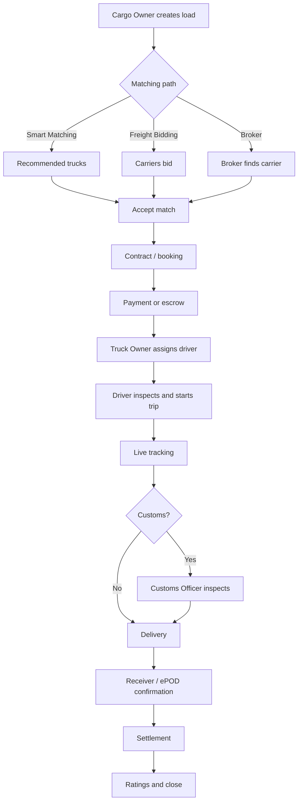

**Financing overlay (optional):** Cargo Owner or Truck Owner requests a loan → Lender assesses and disburses → repayments tracked on the Lender desk.

**Parking overlay (optional):** Driver or fleet reserves a bay → Parking Reservation Manager approves and sets fees.

---

## 2. Cargo Owner

**Home:** `/dashboard`  
**Purpose:** Post cargo, match or bid for trucks, track shipments, pay, finance, and close deliveries.

### What you see on the home dashboard

The home page is an operations snapshot:

- Active cargo counts, pending payments, and recent activity
- Shortcuts to create cargo, open inventory, and track shipments
- Charts for volume and spend over time
- Alerts for KYC, overdue payments, and customs inspections

### How to move around

Top menu groups:

**Dashboard** — home.

**Supply Chain Hub**

| Menu | What it does |
| --- | --- |
| Create Payload | New cargo wizard |
| AI Planner | Distribution campaigns |
| Available space | Buy leftover truck capacity |
| Cargo Inventory | All loads (draft, active, delivered) |
| Smart Matching | AI truck recommendations |
| Accepted Matches | Matches you already accepted |
| Freight Bidding | Open auctions and bid responses |
| Live Tracking | GPS map of active trips |

**Intelligence & Capital**

| Menu | What it does |
| --- | --- |
| Receiver Directory | People who receive your cargo |
| Drafts & Templates | Saved drafts and reusable templates |
| Cargo Inspections | Customs / inspection status |
| Invoice Vault | Invoices |
| Financing | Loan requests |
| Financial | Pending payments and transactions |
| Financial Analytics | Spend and shipment analytics |
| Custom Reports / Generate Reports | Build or export reports |

**Support** — Report Issue and reports.

### Flow A — Post cargo and get it moved

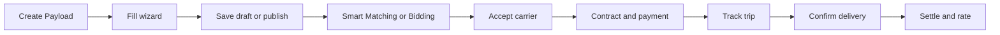

**Step-by-step**

1. Open **Supply Chain Hub → Create Payload**.
2. Optionally pick a **template**, **photos**, or **AI suggestions**.
3. Complete the wizard:
   - **Cargo Details** — type, weight, dimensions, packaging.
   - **Route & Schedule** — pickup, drop-off, dates, urgency.
   - **Handling & Security** — temperature, loading, security needs.
   - **Quality & Documents** — photos and supporting files.
4. Assign a **receiver** if the destination contact should inspect or confirm.
5. Optionally assign a **broker**.
6. **Save as draft** or **publish**.
7. From **Cargo Inventory**, open the load and choose a matching path:
   - **Smart Matching** — review recommended trucks and accept.
   - **Freight Bidding** — open bidding, compare offers, award.
   - **Available space** — book leftover capacity on a truck already on the route.
8. Complete **booking / contract** and **payment** (or request **Financing**).
9. Watch the trip under **Live Tracking**.
10. After delivery, confirm, review **ePOD reports**, settle, and leave a rating.

**Bulk posting:** use **Cargo Inventory** tools or **cargos/bulk-upload** when you have many similar loads.

### Flow B — Pay, finance, and invoices

1. Open **Intelligence & Capital → Financial** for pending payments.
2. Pay from invoices in **Invoice Vault**.
3. For working capital, open **Financing**, submit a loan request, then track status until the lender disburses.
4. Use **Financial Analytics** and **Generate Reports** for month-end.

### Flow C — Receivers, inspections, disputes

- Add destination contacts in **Receiver Directory**.
- Follow **Cargo Inspections** if customs flags the load.
- Open **Support → Report Issue** or **Disputes** if a trip goes wrong.
- Reserve parking from your dashboard when a truck needs a facility bay before pickup or after delivery.

### Daily checklist

- [ ] Review home dashboard alerts
- [ ] Publish or update drafts
- [ ] Respond to matches and bids
- [ ] Confirm deliveries waiting on you
- [ ] Clear pending payments

---

## 3. Cargo Receiver

**Home:** `/dashboard`  
**Purpose:** See cargo assigned to you, track inbound shipments, confirm receipt, and generate reports.

### Navigation

| Menu | What it does |
| --- | --- |
| Overview | Home snapshot of inbound cargo |
| Receiving Hub → My Cargos | List of cargos where you are the receiver |
| Receiving Hub → Live Tracking | Map of inbound trips |
| Receiving Hub → Generate Reports | Export receiving activity |
| Settings | Profile and preferences |

### Flow — Receive cargo

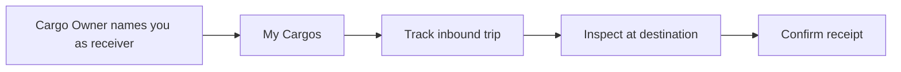

1. Open **My Cargos**.
2. Select a shipment. Check status, documents, and ETA.
3. Use **Live Tracking** while the truck is en route.
4. On arrival, open the cargo and complete **inspection** if requested.
5. Confirm receipt so the cargo owner can settle.

You cannot create new loads. If something is missing, contact the cargo owner; they add you from **Receiver Directory**.

---

## 4. Truck Owner and fleet staff

**Home:** `/dashboard/fleet`  
**Purpose:** Register trucks and drivers, win loads, run trips, manage fuel/credits, and get paid.

### Who uses this dashboard

| Role | Typical access |
| --- | --- |
| **Truck Owner** | Full fleet: trucks, drivers, bids, finance, credits, loans |
| **Fleet Manager** | Same operational breadth as owner, plus analytics |
| **Fleet Dispatcher** | Trucks, drivers, routes, assignments, matching |
| **Fleet Accountant** | Financial, expenses, credits, fuel, analytics |
| **Fleet Safety Officer** | Trucks, drivers, safety, analytics |

Staff accounts are created by the Truck Owner or Tenant Admin (Settings / Users). They log in and land on the same fleet workspace with fewer tabs.

### How to move around

**Dashboard** — fleet overview (utilization, active trips, alerts).

**Fleet & Personnel**

| Menu | What it does |
| --- | --- |
| Driver Directory | Add, invite, and manage drivers |
| Truck Inventory | Register trucks, specs, documents, records |
| Fuel & Maintenance | Fuel wallet, logs, maintenance |
| Safety Records | Incidents, compliance, training |
| Marketplace | Buy operational credits |

**Operations Hub**

| Menu | What it does |
| --- | --- |
| Active Trips | Current and upcoming trips |
| Live Tracking | GPS of assigned trucks |
| Smart Matching | Incoming cargo matches |
| Sell capacity | Offer leftover space |
| Backhaul | Return-load opportunities |
| Freight Bidding | Place and manage bids |
| Route Planning | Build and assign routes |
| Financial | Revenue, expenses, cost analysis |
| Line of Credit | Credit balance and loan requests |

**Support** — issues, your parking reservations, reports.

### Flow A — Make the fleet ready

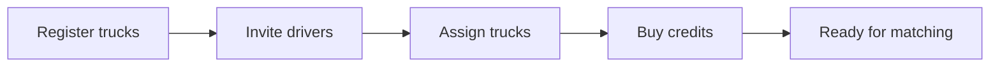

1. Open **Truck Inventory**. Add each truck (type, capacity, plate, insurance, documents).
2. Open **Driver Directory**. Invite drivers. They complete password setup and KYC.
3. Assign a truck to a driver.
4. Complete **Safety Records** and keep licenses current.
5. Buy **credits** from **Marketplace** if bidding or matching requires them.
6. Optional: set **routes** you usually run.

### Flow B — Win a load and run the trip

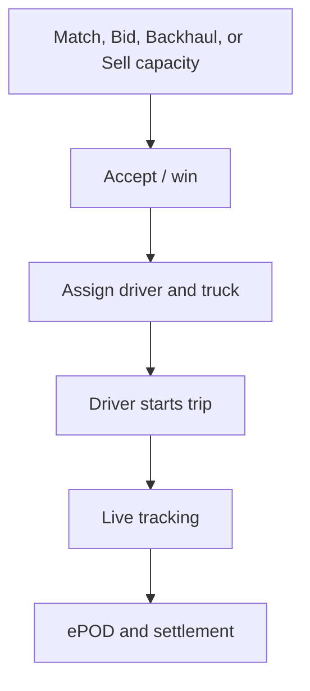

1. Open **Smart Matching** or **Freight Bidding** (or **Backhaul** / **Sell capacity**).
2. Review cargo details (weight, route, rate, dates).
3. Accept a match or submit a bid. Credits may be deducted for bids.
4. When awarded, open **Active Trips** and **assign** driver + truck.
5. Monitor **Live Tracking**. Handle delays, parking, and fuel from the fleet menus.
6. After delivery, review **ePOD reports**, confirm settlement, and check **Financial**.

### Flow C — Money, fuel, and loans

- **Financial** — expenses, cost analysis, reports.
- **Fuel & Maintenance** — wallet, advances, maintenance due.
- **Line of Credit** — request trip financing from lenders.
- Keep **credits** topped up so bidding is not blocked.

### Daily checklist

- [ ] Trucks and drivers available and compliant
- [ ] Respond to matches and open bids
- [ ] Assign unassigned trips
- [ ] Watch live trips and overdue banners
- [ ] Review fuel, expenses, and credit balance

---

## 5. Driver

**Home:** `/dashboard/driver`  
**Purpose:** Execute assigned trips safely: inspect, haul, track, park, deliver, and get paid.

You do not create loads. Your truck owner (or dispatcher) assigns work.

### How to move around

**Dashboard** — today’s trip, earnings snapshot, safety score, announcements.

**Mission Center**

| Menu | What it does |
| --- | --- |
| My Assignments | Current and upcoming trips |
| Live Tracking | Your live map and ETA |
| Inspection & Cargo | Cargo on the truck and inspection hub |
| Operational Announcements | Fleet messages |

**Fleet & Finance**

| Menu | What it does |
| --- | --- |
| My Truck Details | Assigned vehicle |
| Parking Reservation | Book and view parking |
| Safety & Training | Safety records and incidents |
| Earnings Registry | Pay history |
| Performance Metrics | On-time and score trends |
| Wallet & Advances | Fuel / cash advances |
| Generate Reports | Export your activity |

**Support** — Report Issue, parking, reports.  
**Account** — profile.

Inside the dashboard you also have **Messenger**, **Fuel management**, and **Document Vault**.

### Flow — Run a trip

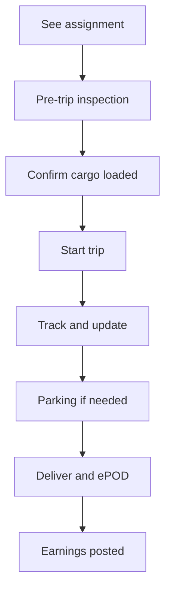

1. Open **Dashboard** or **My Assignments**. Confirm pickup time, route, and cargo.
2. Complete **Inspection** (pre-trip checklist). Do not start until this is done.
3. Confirm cargo on **Inspection & Cargo**.
4. Start the trip. Keep **Live Tracking** on.
5. If you need a bay, open **Parking Reservation**, book, and wait for approval if required.
6. Use **Messenger** for dispatcher questions. Report delays from the trip screen.
7. At destination, complete **proof of delivery** (photos / signature as prompted).
8. Check **Earnings Registry** and **Wallet & Advances** after close.

**If a trip is overdue:** a banner appears on the dashboard. Update status or report delay immediately.

### Daily checklist

- [ ] Inspection complete before rolling
- [ ] Current trip tracking
- [ ] Documents and license not expired
- [ ] Parking booked if the stop requires it
- [ ] Incidents reported the same day

---

## 6. Broker

**Home:** `/dashboard/broker`  
**Purpose:** Receive assigned cargo, find trucks, bid, track, and earn commission.

### How to move around

**Dashboard** — pipeline of assignments, deals, and commissions.

**Operations**

| Menu | What it does |
| --- | --- |
| My Assignments | Loads a cargo owner assigned to you |
| Smart Matching | Recommend trucks for those loads |
| Bidding | Place or manage bids |
| Live Tracking | Trips you facilitated |
| Independent Inspection | Inspection status for those loads |

**Financials** — Commissions and reports.  
**Support** — Report Issue and reports.

Other screens (contracts, insurance, escrow, documents, market intelligence, payouts) open from the dashboard or related assignment.

### Flow — Facilitate a load

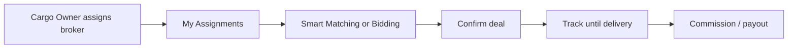

1. Open **My Assignments**. Read cargo, route, and deadline.
2. Use **Smart Matching** to propose trucks, or **Bidding** to compete for capacity.
3. Confirm the deal (contract / insurance if the load requires it).
4. Track under **Live Tracking**. Handle **Independent Inspection** if customs is involved.
5. After delivery, check **Commissions** and **Payouts**.
6. Raise **Disputes** only for loads you facilitated.

### Daily checklist

- [ ] New assignments acknowledged
- [ ] Open bids and matches actioned
- [ ] In-transit loads tracked
- [ ] Commission status reviewed

---

## 7. Lender

**Home:** `/lender`  
**Purpose:** Assess borrowers, approve loans, disburse, collect repayments, and monitor risk.

Cargo owners and truck owners apply from their own **Financing / Line of Credit** screens. You work the loan book here.

### How to move around

**Overview** — totals, pending requests, default rate, recent requests.

**Loan Desk**

| Menu | What it does |
| --- | --- |
| Pending Requests | Approve, reject, or set terms |
| Active Loan Book | Live loans |
| Disbursements | Release funds |
| Repayment Tracking | Collect and flag overdue |

**Risk & Policies**

| Menu | What it does |
| --- | --- |
| Assessment Engine | Credit assessment |
| Lending Policies | Rates, limits, eligibility |
| Borrower Directory | Borrower records |
| Transaction Vault | History |

**Analytics** — portfolio, risk, interest, financial reports, generate reports.  
**Support** — Report Issue.

Profile, team, receipts, and disputes are available from account / related pages.

### Flow — Fund a request

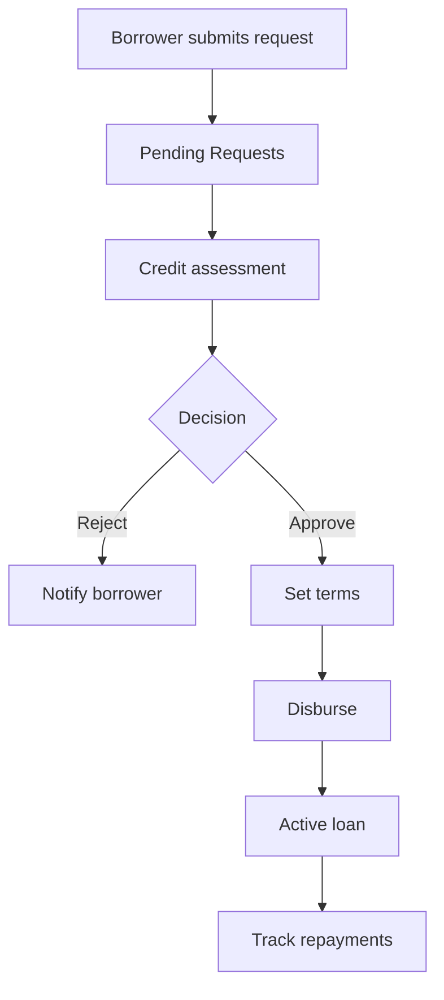

1. Open **Pending Requests**. Filter by status and financing type (cargo owner vs truck-owner trip).
2. Open a request. Review amount, purpose, and borrower history.
3. Run **Assessment Engine** if policy requires it.
4. Approve with terms (amount, rate, due date) or reject with a reason.
5. Move approved items to **Disbursements**. Release funds; retry if a payout fails.
6. Monitor **Active Loan Book** and **Repayment Tracking**. Send reminders for overdue items.
7. Use **Analytics** and **Generate Reports** for portfolio reviews.
8. Adjust **Lending Policies** when risk appetite changes.

### Daily checklist

- [ ] Zero unreviewed pending requests older than your SLA
- [ ] Failed disbursements retried
- [ ] Overdue repayments followed up
- [ ] Policy limits still match risk reports

---

## 8. Tenant Admin

**Home:** `/tenant-admin`  
**Purpose:** Run one organization (tenant): users, fleet, cargo visibility, credits, parking, branding, and support.

You do not replace Cargo Owners or Truck Owners for posting and hauling. You govern the company workspace they work in.

### How to move around

**Dashboard** — tenant KPIs (fleet, cargo, trips, users).

**Operations**

| Menu | What it does |
| --- | --- |
| Fleet | Company trucks |
| Trips | Company trips |
| Cargo | Company loads |
| Drivers | Company drivers |
| Routes | Company routes |
| Users | Invite and manage users and roles |
| Parking Reservations | Facility requests and fees |
| Reports | Tenant reports |

**Commercial**

| Menu | What it does |
| --- | --- |
| Purchase Credits | Buy credits for the organization |
| Communication | Message users by role |

**Support Center** — Issues, Support tickets, Disputes, reports.

Also available: billing, credit marketplace, partner billing, compliance, geofences, integrations, branding, notifications.

### Flow — Stand up the organization

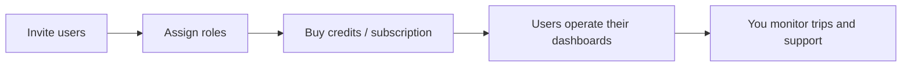

1. Open **Users**. Invite Cargo Owners, Truck Owners, Drivers, Brokers, Lenders, and fleet staff. Choose the correct role.
2. They complete password setup and KYC.
3. Buy **credits** and confirm **billing / subscription**.
4. Optional: set **Branding**, **Integrations**, **Geofences**, and **Communication** templates.
5. Day to day: watch **Fleet / Cargo / Trips**, approve **Parking**, and work **Support Center** (issues, support, disputes).
6. Register **lenders** for the tenant when financing is offered.

### Daily checklist

- [ ] New user invites completed
- [ ] Credit balance sufficient
- [ ] Open support / dispute items triaged
- [ ] Parking requests reviewed

---

## 9. Super Admin and Admin

**Home:** `/admin`  
**Purpose:** Platform-wide control: tenants, users, operations data, finance, lending setup, subscriptions, monitoring.

Use the **left sidebar** (Overview, Management, Operations, Financial, Lending, Subscription, System) plus header groups (Command Center, Operations Suite, Governance, Enterprise Logic, Global Support).

### Sidebar map

| Group | Screens |
| --- | --- |
| Overview | Dashboard, Analytics, Generate Reports |
| Management | Users, Tenants, Routes |
| Operations | Trucks, Loads, Trips, Parking |
| Financial | Transactions, Escrow, Disputes, Bidding |
| Lending | Register lenders, Borrowers |
| Subscription | Plans, pricing, credit usage |
| System | Monitoring, Bulk Email, Onboarding hub |

Account: **Profile / Settings**. Support: **All Tickets** and support analytics.

### Flow — Operate the platform

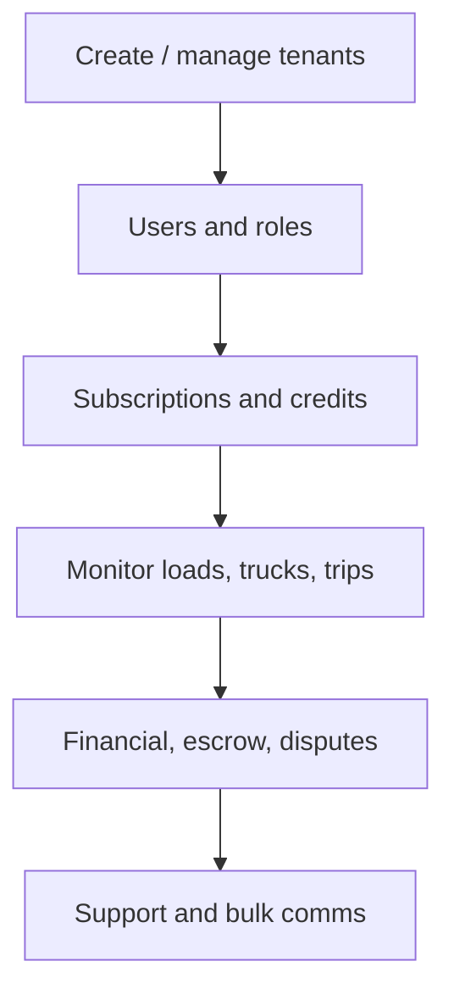

1. **Tenants** — onboard a company. Tenant Admin then invites their users.
2. **Users / Roles / Permissions** — grant or restrict capabilities.
3. **Subscriptions** — plans, pricing rules, credit usage.
4. **Operations** — inspect trucks, loads, trips, and parking when something is stuck.
5. **Financial** — transactions, escrow, bidding oversight, dispute resolution.
6. **Lending** — register lenders (Super Admin can target any tenant).
7. **Monitoring** — system health. **Bulk Email** and **Onboarding** for announcements.
8. **Global Support** — platform tickets and analytics.

Treat this dashboard as governance. Do not use it as a substitute for posting cargo or driving trips.

---

## 10. Operational Admin

**Home:** `/admin-operational`  
**Purpose:** Watch live operations without full platform configuration.

### Navigation

**Dashboard** — operational snapshot.

**Operations Suite**

| Menu | What it does |
| --- | --- |
| Trip Monitoring | All trips in motion |
| Load Management | Loads across tenants |
| Bidding Oversight | Auction health |
| Resolution Center | Disputes |
| Parking Reservations | Facility queue |
| Network Monitoring | Ops monitoring |

**Intelligence & Finance** — Analytics, Financial Overview, Generate Reports, Activity Logs.

Profile and Settings are under the avatar.

### Flow — Daily ops watch

1. Open the **Dashboard**, then **Trip Monitoring**.
2. Filter delayed, disputed, or unassigned trips.
3. Cross-check **Load Management** and **Bidding Oversight**.
4. Work **Resolution Center** and **Parking** queues.
5. Use **Activity Logs** when you need an audit trail.
6. Escalate configuration changes to Super Admin / Tenant Admin.

---

## 11. Customs Officer

**Home:** `/dashboard/customs`  
**Purpose:** Search trucks, inspect cargo, flag or clear shipments, and keep an audit trail.

### How to move around

**Dashboard** — inspection queue and flags.

**Inspections**

| Menu | What it does |
| --- | --- |
| All Inspections | Full list |
| New Inspection | Start an inspection |
| Flagged Cargo | Holds |
| Cleared Shipments | Released cargo |

**Operations** — Truck Search, Checkpoints, Analytics, Audit Log, Generate Reports.

### Flow — Inspect and clear

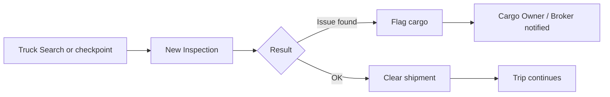

1. Use **Truck Search** (plate, trip, or cargo reference) or a **Checkpoint**.
2. Open **New Inspection**. Record findings and documents.
3. **Flag** cargo that cannot proceed, or **Clear** it.
4. Cargo owners and brokers see status under **Cargo Inspections**.
5. Review **Audit Log** and **Analytics** for reporting.

---

## 12. Parking Reservation Manager

**Home:** `/dashboard/parking/reservations`  
**Purpose:** Approve parking requests and maintain fee settings.

Drivers, cargo owners, and truck owners submit reservations from their own **Parking** menus. Guests can also start from public `/parking-reservation` and look up a booking at `/parking-reservation/lookup`.

### Navigation

| Menu | What it does |
| --- | --- |
| Reservations | Incoming and active bookings |
| Reservation Fees | Price rules |
| Generate Reports | Parking activity export |

### Flow — Process a reservation

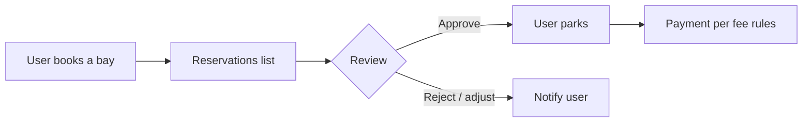

1. Open **Reservations**. Filter by status (pending, approved, completed).
2. Open a row. Check vehicle, dates, facility, and payment.
3. Approve, reject, or update as required.
4. Keep **Reservation Fees** current so new bookings price correctly.
5. Export **Reports** for facility management.

---

## 13. Shared tools

These appear on most dashboards. Paths differ by role; the header always has an equivalent.

### Notifications

The bell lists alerts (matches, bids, assignments, payments, KYC, disputes). Click through to the record. If a link is stale, you land on **resource unavailable** — go back to the list for that module.

### Support and disputes

- **Report Issue** opens a ticket for your tenant support team.
- **Disputes** are for commercial / delivery conflicts on a trip.
- Tenant Admin and platform admins see all tickets in **Support Center**.

### Documents

Upload licenses, insurance, cargo photos, and ePOD files from **Documents** (or Document Vault on driver). Keep expiry dates updated.

### Live tracking

**Live Tracking** is role-scoped: you only see trips you own, haul, broker, or administer.

### Reports

**Generate Reports** exports the datasets your role is allowed to see (trips, cargo, fleet, invoices, payments, credits, loans, parking). Use date and status filters before export.

### Credits (operations currency)

Bidding, matching, and some marketplace actions consume **credits**. Tenant Admin buys a pool; truck owners may also buy from **Marketplace**. If an action is blocked, check credit balance first.

### Parking (all operational roles)

Cargo Owner, Truck Owner, and Driver can open **My Parking Reservations** (or Driver **Parking Reservation**) to book a bay. Managers approve in the parking dashboard.

---

## 14. Quick reference

### After login, where do I go?

| I am a… | Home |
| --- | --- |
| Cargo Owner / Receiver | Dashboard |
| Truck Owner / fleet staff | Fleet dashboard |
| Driver | Driver dashboard |
| Broker | Broker dashboard |
| Lender | Lender overview |
| Tenant Admin | Tenant admin home |
| Super Admin / Admin | Admin command center |
| Operational Admin | Operational dashboard |
| Customs Officer | Customs dashboard |
| Parking manager | Parking reservations |

### “I want to…”

| Goal | Role | Start here |
| --- | --- | --- |
| Ship goods | Cargo Owner | Supply Chain Hub → Create Payload |
| Confirm inbound cargo | Receiver | Receiving Hub → My Cargos |
| Add a truck or driver | Truck Owner | Fleet & Personnel |
| Bid on a load | Truck Owner | Operations Hub → Freight Bidding |
| Start my assigned trip | Driver | Mission Center → My Assignments |
| Find a truck for a client load | Broker | Operations → My Assignments |
| Approve a loan | Lender | Loan Desk → Pending Requests |
| Invite staff | Tenant Admin | Operations → Users |
| Create a company on the platform | Super Admin | Management → Tenants |
| Unstick a delayed trip | Operational Admin | Operations Suite → Trip Monitoring |
| Inspect a truck at a border | Customs Officer | Inspections → New Inspection |
| Approve a parking bay | Parking manager | Reservations |

### Typical status path for a load

`Draft → Published → Matched / Bid awarded → Booked → In transit → (Inspected) → Delivered → Settled`

### If something is missing from the menu

1. Confirm you selected the correct **role** at login.
2. Ask Tenant Admin to grant the permission (bidding, matching, finance, parking, analytics).
3. Complete **KYC** and required documents.
4. For bidding/matching, confirm **credit** balance.

### Get help inside the product

1. Header → **Support** → **Report Issue**.
2. Bell icon for system messages.
3. Role help pages (Cargo / Fleet / Driver Help & Support) from the Support menu.

---

*This manual describes the UrutiX web application as configured for role-based dashboards. Labels follow the in-app navigation. If your tenant has customized branding, the logo and colors may differ; menu structure stays the same.*
